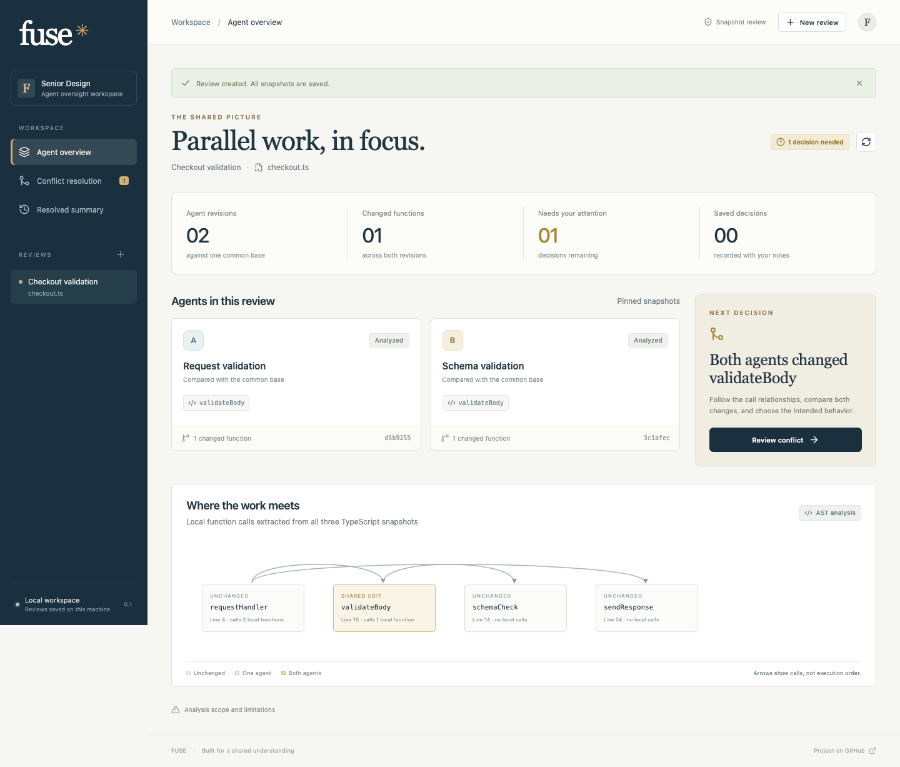

# Fuse

A local oversight workspace for parallel agents’ TypeScript changes. Compare two revisions against their common base, inspect the affected call graph, choose how overlapping changes should behave, and keep a reproducible record of the decision.



## Run it

Use **Node.js 24** (the project includes `.nvmrc`) and npm.

```sh
git clone https://github.com/Will-Sanz/fuse.git
cd fuse
npm ci
npm run dev
```

Open **http://127.0.0.1:5173**. Choose **New review → Checkout example**. No API keys, database service, or AI subscription are required.

To run the production build locally:

```sh
npm run build
npm start
```

Open **http://127.0.0.1:3001**. Stop a running server with Ctrl+C. Both commands bind to this computer; this MVP is not a hosted multi-user service.

## Try the complete workflow

1. Open the checkout example. The overview identifies both agents’ changes to `validateBody`.
2. Select **Review conflict**. Inspect the call relationships and behavior observations extracted from the AST.
3. Choose **Keep A**, **Keep B**, or **Merge both**. For composition, choose **A first, then B** or **B first, then A**. The preview shows the exact generated body.
4. Add a note and save the decision. Generate the resolved file.
5. Download the TypeScript and the JSON review record from **Resolved summary**. Reload the page to confirm the review is saved.

The difference in ordering is real: for an empty order, A-first returns `Your order is incomplete`; B-first returns a specific email error. Automated tests execute this fixed fixture in both orders. The application never executes submitted code.

## What works

- Three views: agent revision overview, focused conflict resolution, and decision history.
- Pasted or uploaded base/A/B versions of a `.ts` file.
- AST analysis through ts-morph: named top-level functions, resolved local call edges, shared-function edits, and conservative shared-path review candidates.
- Automatic assembly of independent function edits, plus reviewer-controlled selection or constrained additive composition for overlaps.
- Behavior observations generated from actual calls, conditions, and error returns.
- Live read-only GitHub import: pin two branch tips, find their merge base, and read one file at those three commits.
- SQLite persistence, revision checks against stale browser tabs, source/output hashes, decision notes, and downloadable audit records.
- Standalone TypeScript diagnostics on the generated file.
- Desktop and mobile layouts, plus CI checks on pushes and pull requests.

## Bring your own code

Choose **New review → TypeScript files**, supply a title and filename, and paste or upload three complete snapshots. An empty snapshot represents an absent file. Use a genuine common base. The limits are 100 KB per snapshot and 150 top-level statements.

Example source files are in [`examples/checkout`](examples/checkout). Start small: one TypeScript file with named top-level function declarations.

### GitHub import and credentials

Choose **New review → GitHub branches** and supply `owner/repository`, two branches or commit IDs, and a relative TypeScript path. Public repositories work without credentials, subject to GitHub’s API rate limit.

For a private repository:

```sh
cp .env.example .env
```

Set `GITHUB_TOKEN` in `.env` to a fine-grained GitHub token with **Contents: read** for that repository. Restart the server. The token stays on the server and is never stored in a review or sent to the browser. Do not commit `.env` or paste tokens into issues or pull requests.

Import reads snapshots only. It does not push code or merge GitHub branches. Review the exported file in the target repository and run its own tests before opening a pull request. No OpenAI, Linear, Slack, or Teams keys are needed for this release.

## Tests and formatting

```sh
npm run check                # Type check, production build, engine/API tests
npx playwright install chromium
npm run test:e2e             # Production-server browser workflows
npm run format:check
npm run format              # Apply consistent formatting
```

The browser tests run an isolated server on port 3101 and use an ignored database under `test-results/`. Engine tests cover observable checkout behavior, independent edits, deletions, unsupported compositions, shadowed calls, and comment preservation. API tests verify persistence, stale-write protection, validation, downloads, and origin restrictions. GitHub tests cover exact commit selection and error handling.

The [Verify Fuse workflow](.github/workflows/ci.yml) runs these checks in GitHub Actions. Browser reports are uploaded when a run fails.

## Scope and limitations

This is the **single-file TypeScript conflict-resolution MVP** from the proposal’s first-semester plan, with the overview and summary surfaces included.

- The overview shows saved revisions, not live running-agent telemetry. Start a new review to fetch new branch snapshots.
- The graph combines statically resolved local calls from all three snapshots. It is not an execution trace. Dynamic dispatch, callbacks, cross-file calls, and runtime conditions are not modeled.
- Shared-path warnings are review candidates, not proof of a semantic conflict or a distributed happens-before relationship. AI judgments are not implemented.
- “Merge both” supports additive top-level statements within a function while preserving the base statement order. Signature changes, replacements, ambiguous anchors, duplicate declarations, and unsupported comment edits block composition. Choosing an order is a human behavior decision, not a correctness guarantee.
- Module-level changes, classes, arrow-function implementations, overloads, and anonymous functions use conservative whole-file selection when both revisions differ. They are not independently reconciled.
- Standalone diagnostics may include missing imports from the original project. Export remains available with diagnostics visible; a successful standalone check is not proof that application tests pass.
- SQLite reviews are local to this computer. There is no user authentication, hosted team synchronization, automated test execution for imported code, or automatic GitHub write-back. Keep the server on loopback; add authentication and deployment hardening before hosting it.
- Linear, Slack, Teams, autonomous agent execution, and AI semantic review are future work. The UI does not pretend these are connected.

## Project layout

```text
src/                  React interface and review components
server/engine.ts      AST analysis, composition, and diagnostics
server/app.ts         Validated HTTP endpoints and review lifecycle
server/store.ts       SQLite storage with revision checks
server/github.ts      Read-only, commit-pinned GitHub imports
shared/               Types and the checkout fixture
examples/checkout/    Uploadable TypeScript snapshots
tests/               Engine, API, GitHub, and browser tests
```

Reviews are stored in `data/fuse.sqlite` by default. The database, its WAL files, `.env`, test reports, and build output are ignored by Git. `FUSE_DB` can select another local database path. Node 24 may print an experimental SQLite warning; it is expected.

See [architecture and API](docs/architecture.md), [MVP scope](docs/MVP.md), and [contributing](CONTRIBUTING.md).
