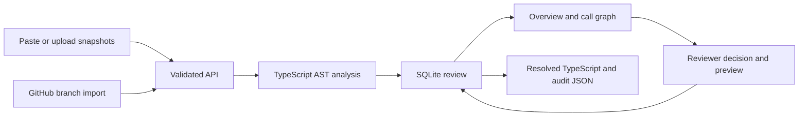

# Architecture

Fuse is a local React application backed by a TypeScript/Express service. Only the server imports ts-morph or reads GitHub credentials. The browser renders analysis results and requests previews, decisions, and exports.

## Analysis

The three snapshots are parsed independently. Invalid syntax is rejected. For the supported subset, functions are matched by name, and edits are classified against the common base. Calls are connected only when a direct identifier resolves to a top-level function declaration; shadowed identifiers and nested callbacks do not produce false local edges.

Overlapping edits that differ become mandatory decisions. Different changed functions with reachability between them or a shared caller create mandatory review acknowledgments. This conservatively narrows the work a reviewer should examine. It does not establish a semantic conflict, runtime execution order, or distributed happens-before relation.

The call graph is the union of all snapshots. An edge can disappear in the chosen result; the UI labels this graph as a review aid rather than a trace of the output.

## Resolution

Unilateral edits and identical changes are retained automatically. Each overlap requires A, B, or supported composition. Additive composition anchors inserted statements around unchanged base statements. Both orders can be previewed. Changed signatures, reordered/replaced base statements, ambiguous repeated anchors, duplicated bindings, and unsupported comment changes disable composition. The result is parsed again and standalone type diagnostics are attached at finalization.

Changes to unsupported constructs use full-file selection to prevent silent loss. The downloadable file is a candidate for the target project’s tests, not an automatically merged Git branch.

## Storage and concurrency

A review contains input snapshots, their SHA-256 hashes, the analysis, current decisions, timestamped events, and any generated output with its hash. SQLite uses WAL mode. Each update compares the supplied revision to the stored revision before replacing the record. A stale writer receives HTTP 409 and must reload.

Updating a decision invalidates a previous output and its diagnostics. History retains the old decision event. Records do not identify a verified human actor; this is a single-user local application, not a tamper-proof audit system.

## HTTP API

All mutations require JSON. Responses under `/api` are not cached.

| Method | Endpoint                        | Purpose                                                                       |
| ------ | ------------------------------- | ----------------------------------------------------------------------------- |
| GET    | `/api/health`                   | Readiness check                                                               |
| GET    | `/api/config`                   | Whether a server-side GitHub token is configured                              |
| GET    | `/api/workspaces`               | Latest 100 review summaries                                                   |
| POST   | `/api/workspaces`               | Create from `title`, `fileName`, `base`, `agentA`, `agentB`, `nameA`, `nameB` |
| POST   | `/api/example`                  | Create the checkout example                                                   |
| POST   | `/api/github/import`            | Import `repository`, `refA`, `refB`, and `fileName`                           |
| GET    | `/api/workspaces/:id`           | Full saved review                                                             |
| POST   | `/api/workspaces/:id/preview`   | Preview `{ revision, conflictId, decision }` without saving                   |
| PATCH  | `/api/workspaces/:id/decisions` | Validate and save that decision payload                                       |
| POST   | `/api/workspaces/:id/finalize`  | Generate output using `{ revision }`                                          |
| GET    | `/api/workspaces/:id/download`  | Download the generated TypeScript                                             |
| GET    | `/api/workspaces/:id/audit`     | Download the complete JSON review record                                      |

A decision has `choice` (`a`, `b`, `both`, or `reviewed`), an optional composition `order` (`a-first` or `b-first`), and a `note`. `reviewed` is used only for dependency candidates. Invalid input returns 400, unsupported resolutions return 422, missing reviews return 404, and stale revisions return 409.

## Boundaries

The server binds to `127.0.0.1`, rejects unexpected Host headers and cross-origin mutation requests, and keeps GitHub credentials on the server. GitHub URLs are constructed against `api.github.com`; arbitrary upstream URLs are not accepted. Remote source is parsed, never executed.

For a hosted team service, add authenticated users and project authorization, durable shared storage, request budgets, isolated analysis workers, and a reviewed deployment configuration. Do not expose this local MVP to the internet as-is.

## Next engineering work

1. Extend reconciliation to project-aware, multi-file TypeScript analysis with explicit supported/unsupported cases.
2. Add agent events and GitHub webhook ingestion, maintaining snapshot provenance and stale-review detection.
3. Evaluate an optional AI explanation stage only on deterministic candidates, with source-grounded output and clear uncertainty.
4. Add authenticated team reviews before shared hosting, followed by Linear/Slack/Teams integrations.
