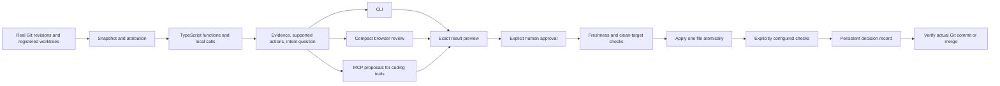

# Architecture

Fuse has one local review service with three adapters: CLI, browser HTTP, and MCP. All adapters use the same Git snapshots, ts-morph analyzer, constrained reconciliation, and decision records.

## Boundaries

- `server/git.ts` reads real Git objects and final working contents. It pins revisions, validates worktree membership, rejects dangerous path traversal/symlinks, limits input size, and includes unsupported changes in the review. Staged and unstaged changes are viewed together as the final working snapshot; the index is not rewritten by inspection.
- `server/engine.ts` retains the original deterministic analyzer and reconciler. Named top-level functions are compared with a common base. Only direct, statically bound calls to local top-level functions produce edges. Callbacks and shadowed identifiers do not imply local edges.
- `server/local.ts` owns session registration, inspection, intent, recommendations, preview, application, check execution, commit verification, and watcher state. No vendor code lives in the engine.
- `server/local-store.ts` writes versioned JSON under the common Git directory’s `fuse/` folder. Atomic replacement plus a per-repository mutation lock prevents competing Fuse writers. Reviews survive process restarts and are shared across that repository’s worktrees.
- `cli/` provides a real executable, structured output, documented exit codes, and a loopback visual server command. `server/mcp.ts` uses the MCP SDK for proposal-only tools.
- `server/review-server.ts` binds the browser to a launch-selected repository or controlled demo registry. It reuses the existing API origin/Host protections and retains the legacy SQLite snapshot/import API.
- `src/` renders focused source evidence, before/after call diagrams, decisions, previews, checks, and history. Standard controls are real open-source Untitled UI components; provenance and license are retained under `src/untitledui/`.

## Evidence and intent

Different edits to one function are a shared edit requiring a decision. Identical edits are retained once. Changes to different functions with a local shared call path are possible interactions, not proven conflicts. Independent changes do not acquire artificial conflict records. The browser shows base/A/B graphs separately; it does not animate edges as execution order.

Recommendations are deterministic. For supported additive composition, explicit intent chooses which side’s insertions precede the other at shared base anchors. Without that intent, Fuse asks a targeted question and exposes the supported choices. The checkout demo supplies a clearly labeled fixture expectation. Static evidence, intended behavior, and actual check results remain separate in the record.

## Reconciliation and application

The existing reconciler preserves unilateral edits and supports whole-function selection or additive composition around unchanged base statements. Replacements, reordered base statements, signature changes, ambiguous anchors, duplicate bindings, and unsupported comment changes disable composition. Whole-file selection provides a safe path for unsupported module-level edits. No source is executed during analysis or preview.

Analysis can report multiple files. Automatic application is restricted to one regular non-executable `.ts` file in a clean target checkout at the exact common base. Unsupported file types and metadata changes block application. A preview pins outputs, hashes, source fingerprints, decisions, and configured check arguments. A stale review revision or wrong token fails before mutation.

Immediately before applying, Fuse rechecks source worktrees, session registration, target HEAD, target content, and clean status. It prepares a sibling temporary file and atomically replaces the single reviewed file (or removes it for an approved deletion). Another editor does not participate in the Fuse lock, so this is optimistic validation rather than an OS-wide filesystem transaction. Avoid simultaneous editor writes during application.

Explicitly configured check commands run after application using executable/argument arrays, no shell, bounded time, and bounded captured output. Repository scripts are not auto-discovered. Check failures keep the local applied result and actual diagnostics for inspection. A check or external process changing the result is recorded; commit verification still requires the exact previewed output.

## Provenance and lifecycle

Reviews store exact supported source snapshots, pinned heads, common base, fingerprints, decisions and rationale, local reviewer identity, timestamps, preview output hashes, and real check results. Unsupported oversized data is represented by metadata rather than copied in full. Local files and Git identity are not verified authentication or a tamper-proof audit.

- **Proposed:** evidence and optional preview, no source application.
- **Applied:** explicitly approved output written locally; check results may pass, fail, or be unverified.
- **Committed:** a real descendant Git commit contains the exact recorded output.
- **Merged:** an actual merge commit integrates the resolution into its first-parent history. A later ordinary commit, downloaded file, or unverified remote PR never suffices. Fast-forward and squash merge status require manual verification outside this release.

The review service does not make commits or invoke repository hooks. Developers commit normally and link the resulting SHA. The demo generator and verification script create normal Git commits only in their own fixture repositories. Watch state records an evidence signature so unchanged overlap does not repeat alerts. Any changed input creates refreshed analysis; unrelated changes do not repeat an unchanged overlap notification.

## Limits

TypeScript only; 80 changed files; 100 KB per snapshot; 150 top-level statements per file. Cross-file dependency resolution, callbacks, dynamic behavior, autonomous merge, general CRDT, remote identity, hosted multi-user access, and LLM explanations are outside this release. There are no paid-key requirements for the core demo.
