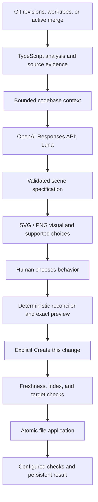

# Fuse architecture

Fuse separates source evidence, AI explanation, human intent, and deterministic code application.

## Modules

- `server/git.ts`: reads real Git objects, worktree contents, and active merge state. Pins commits and content fingerprints; bounds ordinary source snapshots; rejects unsafe paths, symlinks, and unsupported modes. Active merge snapshots use HEAD, MERGE_HEAD, common base, and the unresolved index plus marker-file contents.
- `server/engine.ts`: deterministic ts-morph analysis and constrained reconciliation for named top-level TypeScript functions. Direct local calls produce possible-interaction evidence, never proof of runtime order.
- `server/local.ts`: inspection, explicit worktree registration, intent, decisions, preview, application, checks, Git linking, and watch deduplication. One-file application is bounded to a clean base checkout or the exact reviewed active merge with no unrelated changes.
- `server/local-store.ts`: atomic JSON records under the common Git directory's `fuse/` folder and a per-repository mutation lock.
- `server/visual-ai.ts`: bounded pinned context, OpenAI Responses API request, schema/action validation, one repair attempt, cache/provenance, and freshness checks before saving. `.env` loading belongs to the installation entry point. Errors are explicit; prepared visuals are never a silent AI fallback.
- `server/visual-renderer.ts`: escaped text and fixed drawing primitives, geometry/text-fit validation, SVG rendering, and resvg PNG output. No arbitrary model HTML or code execution.
- `server/mcp.ts`: vendor-independent stdio interface. AI tools return text data plus an actual PNG image. Source application and command execution are intentionally absent from MCP.
- `cli/`: executable, JSON and exit codes, inspection/watch tools, and the loopback review server. `scripts/meeting.mjs` is the portable live MCP client and disposable-conflict walkthrough.
- `server/review-server.ts`: repository-bound browser API; retains legacy snapshot/import routes. Mutations enforce local origin and Host restrictions.
- `src/`: the three-step source/visual/choice review. Standard buttons, dialogs, and loading indicators use the MIT Untitled UI implementation with provenance retained under `src/untitledui/`.

## Two browser runtimes

Local mode uses the real review API and filesystem. Browser examples create controlled Git repositories with prepared visuals. The meeting runner instead creates a true merge conflict and calls the real AI MCP before opening the same UI.

Vercel hosts a static build selected by Vite's `showcase` mode. `scripts/build-showcase.mjs` runs the shared analyzer and reconciler to produce both examples, supported output variants, and prepared SVGs. The browser adapter persists one example in session storage and creates downloadable files. It does not call OpenAI, expose local paths, write a Git repository, or claim checks ran. `.env`, local fixtures, and traces are excluded from deployment uploads. Public MCP imagery is explicitly captured from the controlled fixture.

## Application and provenance

The reconciler preserves unilateral edits and can select whole functions or combine additive edits around unchanged base statements. Replacements, signature changes, ambiguous anchors, reordered base statements, duplicate bindings, and unsupported comments disable composition. Imported source is parsed, never executed during inspection or preview.

Preview pins decisions, source fingerprints, output hashes, and configured check commands. Apply rechecks source, review revision, target HEAD, target contents, and token immediately before writing. An active merge additionally pins MERGE_HEAD, unresolved index entries, and marker-file contents. Unrelated staged, unstaged, or untracked work blocks merge application. The approved file is atomically replaced and staged for the unresolved merge; no merge commit is made. Another editor can still race outside Fuse's lock, so this is optimistic validation rather than a filesystem-wide transaction.

Checks are explicitly configured executable/argument arrays, run without a shell after application, with time and output bounds. Actual failures remain recorded; no checks means unverified. The record preserves inputs, AI context/provenance, rationale, outputs, actual check results, and local Git identity. It is local attribution, not authenticated identity or a tamper-proof audit.

Statuses progress from proposed to applied to a verified descendant commit and then a verified merge commit. Git commit/merge linking requires the exact recorded output. A download is never a verified Git commit or merge. The review service does not commit or push; fixture construction and acceptance scripts commit only controlled disposable repositories.

## Limits

TypeScript named top-level functions, direct local calls, 80 changed files, 100 KB per snapshot, and 150 top-level statements per file. AI context includes at most ten files with 6,000 characters each plus selected change snapshots and a bounded tree listing. Context is pinned to the inspected target commit; it is not full cross-file semantic analysis. AI can make explanatory mistakes; tests remain the runtime evidence. The compact UI focuses on one conflict and one automatic file application. Broader edits require the structured CLI/manual workflow. No autonomous merge, CRDT, or hosted multi-user backend is included.
